Sign in to Veil Admin
Manage servers, AWS accounts, devices and rewards.
Email
Password Forgot password?
Authentication code
From your authenticator app.
Sign in
After 5 failed attempts, sign-in is locked for 15 minutes.

Veil
| Admin | Dashboard |     |     |     |     |     | Production | Updated 14:32 |     |
| ----- | --------- | --- | --- | --- | --- | --- | ---------- | ------------- | --- |
Search
Admin console
Dashboard 3
Dashboard
Infrastructure Live overview of your VPN fleet. Numbers refresh every 60 seconds.
AWS accounts
Needs attention 3
Servers 1
Server never registered
Regions View server
i-0a3f…091c in London (eu-west-2) has been provisioning for 12 minutes.
Users
AWS keys rejected
Update keys
Devices Account “Backup” can no longer connect to AWS. Its keys may have been deleted or rotated.
Rewards
Free data limit at 82%
View usage
Account “Main” has used 82 of 100 GB of free data transfer this month.
System
Settings
Active servers Online now New devices today Ads watched today Minutes granted today
| 6   |     | 214 |     | 87  |     | 1,342 | 40,260 |     |     |
| --- | --- | --- | --- | --- | --- | ----- | ------ | --- | --- |
in 5 regions +18 vs this time yesterday +12% vs yesterday +7% vs yesterday from verified ads
| Free-tier usage this month |     |     |     |     |     | Servers by region |     | View servers |     |
| -------------------------- | --- | --- | --- | --- | --- | ----------------- | --- | ------------ | --- |
View accounts
Warning at 80% of each limit
|      |     |         |             |          |             | Region       | Servers |     | Online |
| ---- | --- | ------- | ----------- | -------- | ----------- | ------------ | ------- | --- | ------ |
| Main |     | Compute | 466 / 750 h | Data out | 82 / 100 GB |              |         |     |        |
|      |     |         |             |          |             | DE Frankfurt |         | 2   | 96     |
|      |     | Compute | 310 / 750 h | Data out | 37 / 100 GB | GB London    |         | 1   | 41     |
EU-2
|        |     |         |             |          |             | US Virginia |     | 1   | 38  |
| ------ | --- | ------- | ----------- | -------- | ----------- | ----------- | --- | --- | --- |
| Asia-1 |     | Compute | 138 / 750 h | Data out | 12 / 100 GB |             |     |     |     |
|        |     |         |             |          |             | IN Mumbai   |     | 1   | 24  |
|        |     |         |             |          |             | Singapore   |     | 1   | 15  |
SG
Admin
A
[admin email]

Veil
Admin console
Dashboard 3
Infrastructure
AWS accounts
Servers 1
Regions
Users
Devices
Rewards
System
Settings
Admin
A
[admin email]

| Admin | Dashboard | Production | Updated 14:32 |
| ----- | --------- | ---------- | ------------- |
Search

Veil
|     | Admin | AWS accounts |     |     |     | Production | Updated 14:32 |
| --- | ----- | ------------ | --- | --- | --- | ---------- | ------------- |
Search
Admin console
Dashboard 3
AWS accounts
Add AWS account
| Infrastructure | The AWS accounts your servers run in. Keys are encrypted before they're stored. |     |     |     |     |     |     |
| -------------- | ------------------------------------------------------------------------------- | --- | --- | --- | --- | --- | --- |
AWS accounts
Use an IAM user that can only manage EC2, never root keys. Keep each account standalone: accounts linked in AWS Organizations share one free tier.
Servers 1
Regions Account Access key Status Servers Compute this month Data out this month
Actions
| Users | Main |     |           |         |              |              |     |
| ----- | ---- | --- | --------- | ------- | ------------ | ------------ | --- |
|       |      |     |           |         | 466 of 750 h | 82 of 100 GB |     |
|       |      |     | AKIA…7Q2F | Working | 3            |              |     |
Added Sep 2, 2026
Devices
EU-2
| Rewards |     |     |           |         | 310 of 750 h | 37 of 100 GB |     |
| ------- | --- | --- | --------- | ------- | ------------ | ------------ | --- |
|         |     |     | AKIA…K9MD | Working | 2            |              |     |
Added Sep 18, 2026
System
Asia-1
|          |                   |     |           |         | 138 of 750 h | 12 of 100 GB |     |
| -------- | ----------------- | --- | --------- | ------- | ------------ | ------------ | --- |
|          |                   |     | AKIA…3XWB | Working | 1            |              |     |
| Settings | Added Oct 1, 2026 |     |           |         |              |              |     |
Backup
|     |     |     |           |               | 0 0 of 750 h | 0 of 100 GB |     |
| --- | --- | --- | --------- | ------------- | ------------ | ----------- | --- |
|     |     |     | AKIA…P0LZ | Keys rejected |              |             |     |
Added Oct 4, 2026
4 accounts
Admin
A
[admin email]

| Veil |       |              |     |     |     | Add AWS account |            |               |
| ---- | ----- | ------------ | --- | --- | --- | --------------- | ---------- | ------------- |
|      | Admin | AWS accounts |     |     |     |                 | Production | Updated 14:32 |
Search
Admin console
Paste an access key for an EC2-only IAM user.
Dashboard 3
AWS accounts
Nickname
Add AWS account
| Infrastructure | The AWS accounts your servers run in. Keys are encrypted before they're stored. |     |     |     |     |     |     |     |
| -------------- | ------------------------------------------------------------------------------- | --- | --- | --- | --- | --- | --- | --- |
AWS accounts
Use an IAM user that can only manage EC2, never root keys. Keep each account standalone: accounts linkedO innl yA yWouS  sOeerg tahnisi.z aUtsioen sso msheathrein go nyeo ufr'lel ree ctioegr.nise.
Servers 1
Access key ID
Regions Account Access key Status Servers Compute this month Data out this month
Actions
| Users | Main |     |           |         |              |                   |              |     |
| ----- | ---- | --- | --------- | ------- | ------------ | ----------------- | ------------ | --- |
|       |      |     |           |         | 466 of 750 h |                   | 82 of 100 GB |     |
|       |      |     | AKIA…7Q2F | Working | 3            | Secret access key |              |     |
Added Sep 2, 2026
Devices
EU-2
| Rewards |     |     |           |         | 310 of 750 h |     | 37 of 100 GB |     |
| ------- | --- | --- | --------- | ------- | ------------ | --- | ------------ | --- |
|         |     |     | AKIA…K9MD | Working | 2            |     |              |     |
Added Sep 18, 2026 AWS shows the secret only once, when you create the key. How to
create EC2-only keys
System
Asia-1
|          |                   |     |           |         | 138 of 750 h |     | 12 of 100 GB |     |
| -------- | ----------------- | --- | --------- | ------- | ------------ | --- | ------------ | --- |
|          |                   |     | AKIA…3XWB | Working | 1            |     | Test again   |     |
| Settings | Added Oct 1, 2026 |     |           |         |              |     |              |     |
Backup
|     |     |     |           |               | 0 0 of 750 h | Keys accepted by AWS | 0 of 100 GB |     |
| --- | --- | --- | --------- | ------------- | ------------ | -------------------- | ----------- | --- |
|     |     |     | AKIA…P0LZ | Keys rejected |              |                      |             |     |
Added Oct 4, 2026
Can launch and terminate EC2 instances
Free-tier eligible
4 accounts
Admin
Cancel Save account
A
[admin email]

Veil
|     | Admin | Servers |     |     |     |     |     |     |     | Production | Updated 14:32 |     |
| --- | ----- | ------- | --- | --- | --- | --- | --- | --- | --- | ---------- | ------------- | --- |
Search
Admin console
Dashboard 3
Servers
Create server
| Infrastructure | Every VPN server across all your AWS accounts. |     |     |     |     |     |     |     |     |     |     |     |
| -------------- | ---------------------------------------------- | --- | --- | --- | --- | --- | --- | --- | --- | --- | --- | --- |
AWS accounts
ARcecgoiounnt
|     | All | 6 Active | 4 Provisioning | 0 Draining | 1 Failed | 1   |     |     |     |     |     |     |
| --- | --- | -------- | -------------- | ---------- | -------- | --- | --- | --- | --- | --- | --- | --- |
Servers 1
|         | Server |     |     | Account |     | Public IP | Status | Devices | CPU | Uptime | In app |         |
| ------- | ------ | --- | --- | ------- | --- | --------- | ------ | ------- | --- | ------ | ------ | ------- |
| Regions |        |     |     |         |     |           |        |         |     |        |        | Actions |
Frankfurt
| Users |              |     |              | Main |     | 3.121.48.207 | Active | 58  | 22% | 6d 4h |     |     |
| ----- | ------------ | --- | ------------ | ---- | --- | ------------ | ------ | --- | --- | ----- | --- | --- |
|       | i-07c2…a14e  | ·   | eu-central-1 |      |     |              |        |     |     |       |     |     |
Devices
Frankfurt
|         |              |     |              | EU-2 |     | 18.194.10.63 | Active | 38  | 17% | 2d 11h |     |     |
| ------- | ------------ | --- | ------------ | ---- | --- | ------------ | ------ | --- | --- | ------ | --- | --- |
| Rewards | i-0b91…77f0  | ·   | eu-central-1 |      |     |              |        |     |     |        |     |     |
London
| System |              |     |           | Main |     | 35.177.92.14 | Active | 41  | 19% | 9d 1h |     |     |
| ------ | ------------ | --- | --------- | ---- | --- | ------------ | ------ | --- | --- | ----- | --- | --- |
|        | i-02de…c3b9  | ·   | eu-west-2 |      |     |              |        |     |     |       |     |     |
Settings
London
|     |     |     |     | EU-2 |     | —   |     | 0   | —   | 12m |     |     |
| --- | --- | --- | --- | ---- | --- | --- | --- | --- | --- | --- | --- | --- |
Failed
|     | i-0a3f…091c  | ·   | eu-west-2 |     |     |     |     |     |     |     |     |     |
| --- | ------------ | --- | --------- | --- | --- | --- | --- | --- | --- | --- | --- | --- |
Virginia
|     |     |     |     | Main |     | 44.201.7.180 |     | 12  | 8%  | 12d 6h |     |     |
| --- | --- | --- | --- | ---- | --- | ------------ | --- | --- | --- | ------ | --- | --- |
Draining
|     | i-0e44…5d21  | ·   | us-east-1 |     |     |     |     |     |     |     |     |     |
| --- | ------------ | --- | --------- | --- | --- | --- | --- | --- | --- | --- | --- | --- |
Mumbai
|     |                |     |            | Asia-1 |     |              |        | 24  | 9%  | 4d 20h |          |      |
| --- | -------------- | --- | ---------- | ------ | --- | ------------ | ------ | --- | --- | ------ | -------- | ---- |
|     |                |     |            |        |     | 13.233.150.9 | Active |     |     |        |          |      |
|     | i-09f1…e802    | ·   | ap-south-1 |        |     |              |        |     |     |        |          |      |
|     | 6 of 6 servers |     |            |        |     |              |        |     |     |        | Previous | Next |
Admin
A
[admin email]

| Veil |       |         |     |     |     |     |     | Create server |     |            |               |     |
| ---- | ----- | ------- | --- | --- | --- | --- | --- | ------------- | --- | ---------- | ------------- | --- |
|      | Admin | Servers |     |     |     |     |     |               |     | Production | Updated 14:32 |     |
Search
Admin console
Launches a new VPN server on AWS.
Dashboard 3
Servers
AWS account
Create server
| Infrastructure | Every VPN server across all your AWS accounts. |     |     |     |     |     |     |     |     |     |     |     |
| -------------- | ---------------------------------------------- | --- | --- | --- | --- | --- | --- | --- | --- | --- | --- | --- |
AWS accounts
440 free compute hours left ARthceiscg moioounnntht in EU-2.
|     | All | 6 Active | 4 Provisioning | 0 Draining | 1 Failed | 1   |     |     |     |     |     |     |
| --- | --- | -------- | -------------- | ---------- | -------- | --- | --- | --- | --- | --- | --- | --- |
Servers 1
Region
|         | Server |     |     | Account |     | Public IP | Status | Devices | CPU | Uptime | In app |         |
| ------- | ------ | --- | --- | ------- | --- | --------- | ------ | ------- | --- | ------ | ------ | ------- |
| Regions |        |     |     |         |     |           |        |         |     |        |        | Actions |
Frankfurt
| Users |              |     |              | Main |     | 3.121.48.207 | Active | 58            | 22% | 6d 4h |     |     |
| ----- | ------------ | --- | ------------ | ---- | --- | ------------ | ------ | ------------- | --- | ----- | --- | --- |
|       | i-07c2…a14e  | ·   | eu-central-1 |      |     |              |        | Instance type |     |       |     |     |
Devices
|     | Frankfurt |     |     |      |     |              |        | t3.micro |     |        |     |     |
| --- | --------- | --- | --- | ---- | --- | ------------ | ------ | -------- | --- | ------ | --- | --- |
|     |           |     |     | EU-2 |     | 18.194.10.63 | Active | 38       | 17% | 2d 11h |     |     |
Free tier
Rewards i-0b91…77f0  ·  eu-central-1 2 vCPU, 1 GB memory. Recommended.
London
| System |              |     |           | Main |     | 35.177.92.14 | Active | t241.micro19% |     | 9d 1h |     |           |
| ------ | ------------ | --- | --------- | ---- | --- | ------------ | ------ | ------------- | --- | ----- | --- | --------- |
|        | i-02de…c3b9  | ·   | eu-west-2 |      |     |              |        |               |     |       |     | Free tier |
1 vCPU, 1 GB memory. For regions without t3.
Settings
London
|     |     |     |     | EU-2 |     | —   |     | 0   | —   | 12m |     |     |
| --- | --- | --- | --- | ---- | --- | --- | --- | --- | --- | --- | --- | --- |
Failed
|     | i-0a3f…091c  | ·   | eu-west-2 |     |     |     |     |     |     |     |     |     |
| --- | ------------ | --- | --------- | --- | --- | --- | --- | --- | --- | --- | --- | --- |
What happens next
Virginia 1 The instance launches with only UDP 51820 and TCP 443
|     |     |     |     | Main |     | 44.201.7.180 |     | 12  | 8%  | 12d 6h |     |     |
| --- | --- | --- | --- | ---- | --- | ------------ | --- | --- | --- | ------ | --- | --- |
Draining
|     | i-0e44…5d21  | ·   | us-east-1 |     |     |     |     | open. |     |     |     |     |
| --- | ------------ | --- | --------- | --- | --- | --- | --- | ----- | --- | --- | --- | --- |
On first boot it installs WireGuard and the Veil agent.
2
Mumbai
|     |     |     |     | Asia-1 |     |              |        | 24  | 9%  | 4d 20h |     |     |
| --- | --- | --- | --- | ------ | --- | ------------ | ------ | --- | --- | ------ | --- | --- |
|     |     |     |     |        |     | 13.233.150.9 | Active |     |     |        |     |     |
i-09f1…e802  ·  ap-south-1 3 It registers with the backend and turns Active, usually
within 2 minutes.
|     | 6 of 6 servers |     |     |     |     |     |     |     |     |     | Previous | Next |
| --- | -------------- | --- | --- | --- | --- | --- | --- | --- | --- | --- | -------- | ---- |
Admin
|     |     |     |     |     |     |     |     |     |     | Cancel | Create server |     |
| --- | --- | --- | --- | --- | --- | --- | --- | --- | --- | ------ | ------------- | --- |
A
[admin email]

Veil
|     | Admin | Servers |     |     |     |     |     |     |     |     | Production | Updated 14:32 |     |
| --- | ----- | ------- | --- | --- | --- | --- | --- | --- | --- | --- | ---------- | ------------- | --- |
Search
Admin console
Dashboard 3
Servers
Create server
| Infrastructure | Every VPN server across all your AWS accounts. |     |     |     |     |     |     |     |     |     |     |     |     |
| -------------- | ---------------------------------------------- | --- | --- | --- | --- | --- | --- | --- | --- | --- | --- | --- | --- |
AWS accounts
ARcecgoiounnt
|     | All | 6 Active | 4 Provisioning | 0   | Draining | 1 Failed | 1   |     |     |     |     |     |     |
| --- | --- | -------- | -------------- | --- | -------- | -------- | --- | --- | --- | --- | --- | --- | --- |
Servers 1
|         | Server |     |     |     | Account |     | Public IP | Status | Devices | CPU | Uptime | In app |         |
| ------- | ------ | --- | --- | --- | ------- | --- | --------- | ------ | ------- | --- | ------ | ------ | ------- |
| Regions |        |     |     |     |         |     |           |        |         |     |        |        | Actions |
Frankfurt
| Users |              |     |              |     | Main |     | 3.121.48.207 | Active | 58  | 22% | 6d 4h |     |     |
| ----- | ------------ | --- | ------------ | --- | ---- | --- | ------------ | ------ | --- | --- | ----- | --- | --- |
|       | i-07c2…a14e  | ·   | eu-central-1 |     |      |     |              |        |     |     |       |     |     |
Devices
Frankfurt
|         |              |     |              |     | EU-2 |     | 18.194.10.63 | Active | 38  | 17% | 2d 11h |     |     |
| ------- | ------------ | --- | ------------ | --- | ---- | --- | ------------ | ------ | --- | --- | ------ | --- | --- |
| Rewards | i-0b91…77f0  | ·   | eu-central-1 |     |      |     |              |        |     |     |        |     |     |
London
| System |              |     |           |            | Main       |         | 35.177.92.14 | Active | 41  | 19% | 9d 1h |     |     |
| ------ | ------------ | --- | --------- | ---------- | ---------- | ------- | ------------ | ------ | --- | --- | ----- | --- | --- |
|        | i-02de…c3b9  | ·   | eu-west-2 |            |            |         |              |        |     |     |       |     |     |
|        |              |     |           | Terminate  | Frankfurt  | server? |              |        |     |     |       |     |     |
Settings
58 connected devices will be moved to another server in the same
London
|     |              |     |           |                                                                        | EU-2 |     | —   |        | 0   | —   | 12m |     |     |
| --- | ------------ | --- | --------- | ---------------------------------------------------------------------- | ---- | --- | --- | ------ | --- | --- | --- | --- | --- |
|     |              |     |           | region, or disconnected if there is none. The instance i-07c2…a14e is  |      |     |     | Failed |     |     |     |     |     |
|     | i-0a3f…091c  | ·   | eu-west-2 |                                                                        |      |     |     |        |     |     |     |     |     |
deleted from AWS. This can't be undone.
Virginia
|     |     |     |     |     | Main |     | 44.201.7.180 |     | 12  | 8%  | 12d 6h |     |     |
| --- | --- | --- | --- | --- | ---- | --- | ------------ | --- | --- | --- | ------ | --- | --- |
Draining
|     | i-0e44…5d21  | ·   | us-east-1 |     |     |     |     |     |     |     |     |     |     |
| --- | ------------ | --- | --------- | --- | --- | --- | --- | --- | --- | --- | --- | --- | --- |
To move users without interruption, drain the server first and
terminate it once it's empty.
Mumbai
|     |                |     |            |     | Asia-1 |        |               |           | 24  | 9%  | 4d 20h |          |      |
| --- | -------------- | --- | ---------- | --- | ------ | ------ | ------------- | --------- | --- | --- | ------ | -------- | ---- |
|     |                |     |            |     |        |        | 13.233.150.9  | Active    |     |     |        |          |      |
|     | i-09f1…e802    | ·   | ap-south-1 |     |        |        |               |           |     |     |        |          |      |
|     |                |     |            |     |        | Cancel | Drain instead | Terminate |     |     |        |          |      |
|     | 6 of 6 servers |     |            |     |        |        |               |           |     |     |        | Previous | Next |
Admin
A
[admin email]

Veil
| Admin | Devices |     |     |     |     |     |     | Production | Updated 14:32 |     |
| ----- | ------- | --- | --- | --- | --- | --- | --- | ---------- | ------------- | --- |
Search
Admin console
Dashboard 3
Devices
Infrastructure Shows each device's current state only. Connection history and traffic are never stored.
AWS accounts
| All | 12,408 Connected | 214 Offline | 12,173 | Blocked 21 |     |     |     |     |     |     |
| --- | ---------------- | ----------- | ------ | ---------- | --- | --- | --- | --- | --- | --- |
Search
Servers 1
by
| Device ID |     | Status |     |     | Balance | First seen | device  | Last seen |     |     |
| --------- | --- | ------ | --- | --- | ------- | ---------- | ------- | --------- | --- | --- |
Regions Open
ID
| 4c1e…9a07 |     | Connected · Frankfurt · UDP |     |     | 42 min | Oct 2, 2026 |     | Now |     |     |
| --------- | --- | --------------------------- | --- | --- | ------ | ----------- | --- | --- | --- | --- |
Users
Devices
| 9e03…7b4c |     | Connected · London · TCP |     |     | 1h 05m | Sep 28, 2026 |     | Now |     |     |
| --------- | --- | ------------------------ | --- | --- | ------ | ------------ | --- | --- | --- | --- |
Rewards
| a71f…c2d8 |     | Offline |     |     | 0 min | Oct 9, 2026 |     | 12 min ago |     |     |
| --------- | --- | ------- | --- | --- | ----- | ----------- | --- | ---------- | --- | --- |
System
| b7d2…01fe |     | Blocked |     |     | 3h 20m | Oct 10, 2026 |     | 1 h ago |     |     |
| --------- | --- | ------- | --- | --- | ------ | ------------ | --- | ------- | --- | --- |
Settings
| 1d88…e5a2              |     | Connected · Mumbai · UDP   |     |     | 18 min | Oct 6, 2026  |     | Now        |          |      |
| ---------------------- | --- | -------------------------- | --- | --- | ------ | ------------ | --- | ---------- | -------- | ---- |
| f2b4…3c91              |     | Offline                    |     |     | 2h 10m | Sep 21, 2026 |     | Yesterday  |          |      |
| 60ac…d417              |     | Connected · Virginia · UDP |     |     | 7 min  | Oct 11, 2026 |     | Now        |          |      |
| c3e9…8f60              |     | Offline                    |     |     | 55 min | Oct 3, 2026  |     | 3 days ago |          |      |
| 1–50 of 12,408 devices |     |                            |     |     |        |              |     |            | Previous | Next |
Admin
A
[admin email]

Veil
| Admin | Devices |     |     |     |     | 4c1e…9a07 |     | Production | Updated 14:32 |     |
| ----- | ------- | --- | --- | --- | --- | --------- | --- | ---------- | ------------- | --- |
Search
Admin console
Connected · Frankfurt · UDP
Dashboard 3
Devices
|     |     |     |     |     |     | Balance |     | Ads today |     |     |
| --- | --- | --- | --- | --- | --- | ------- | --- | --------- | --- | --- |
Infrastructure Shows each device's current state only. Connection history and traffic are never stored.
|     |     |     |     |     |     | 42 min |     | 3 of 10 |     |     |
| --- | --- | --- | --- | --- | --- | ------ | --- | ------- | --- | --- |
AWS accounts
|     |                  |             |        |            |     | Current server     |     | Protocol |     |     |
| --- | ---------------- | ----------- | ------ | ---------- | --- | ------------------ | --- | -------- | --- | --- |
| All | 12,408 Connected | 214 Offline | 12,173 | Blocked 21 |     |                    |     |          |     |     |
|     |                  |             |        |            |     | i-07c2…a14eSearch  |     | UDP      |     |     |
Servers 1
by
Device ID Status Balance First Fsiersetn seen device  Last seeLnast seen
Regions Open
|     |     |     |     |     |     | Oct 2, 2026 |     | Now |     |     |
| --- | --- | --- | --- | --- | --- | ----------- | --- | --- | --- | --- |
ID
| 4c1e…9a07 |     | Connected · Frankfurt · UDP |     |     | 42 min | Oct 2, 2026 |     | Now |     |     |
| --------- | --- | --------------------------- | --- | --- | ------ | ----------- | --- | --- | --- | --- |
Users
Devices Adjust minutes
| 9e03…7b4c |     | Connected · London · TCP |     |     | 1h 05m | Sep 28, 2026 |         | Now     |     |     |
| --------- | --- | ------------------------ | --- | --- | ------ | ------------ | ------- | ------- | --- | --- |
|           |     |                          |     |     |        | +15 min      | +30 min | +60 min |     |     |
Rewards
| a71f…c2d8 |     | Offline |     |     | 0 min | Oct 9, 2026 |     | 12 min ago |     |     |
| --------- | --- | ------- | --- | --- | ----- | ----------- | --- | ---------- | --- | --- |
Custom
Apply
System
minutes
| b7d2…01fe |     | Blocked |     |     | 3h 20m | Oct 10, 2026 |     | 1 h ago |     |     |
| --------- | --- | ------- | --- | --- | ------ | ------------ | --- | ------- | --- | --- |
Settings
Connection
| 1d88…e5a2 |     | Connected · Mumbai · UDP |     |     | 18 min | Oct 6, 2026 |     | Now |     |     |
| --------- | --- | ------------------------ | --- | --- | ------ | ----------- | --- | --- | --- | --- |
Disconnect now
| f2b4…3c91 |     | Offline |     |     | 2h 10m | Sep 21, 2026 |     | Yesterday |     |     |
| --------- | --- | ------- | --- | --- | ------ | ------------ | --- | --------- | --- | --- |
Ends the current session. The device can reconnect if it has minutes.
| 60ac…d417 |     | Connected · Virginia · UDP |     |     | 7 min | Oct 11, 2026 |     | Now |     |     |
| --------- | --- | -------------------------- | --- | --- | ----- | ------------ | --- | --- | --- | --- |
Block device
| c3e9…8f60 |     | Offline |     |     | 55 min | Oct 3, 2026 |     | 3 days ago |     |     |
| --------- | --- | ------- | --- | --- | ------ | ----------- | --- | ---------- | --- | --- |
Reason (only admins see this)
| 1–50 of 12,408 devices |     |     |     |     |     |     |     |     | Previous | Next |
| ---------------------- | --- | --- | --- | --- | --- | --- | --- | --- | -------- | ---- |
Disconnects the device immediately and stops its rewards. The
block also applies after a reinstall.
Block device
Admin
A
[admin email]

Veil
|     | Admin | Regions |     |     | Production | Updated 14:32 |
| --- | ----- | ------- | --- | --- | ---------- | ------------- |
Search
Admin console
Dashboard 3
Regions
Infrastructure Choose which locations appear in the app and how they're named. Hiding a region keeps its servers running.
AWS accounts
Name in app AWS region Active servers Visible to users Shown in app
Servers 1
|     | DE  |     | eu-central-1 | 2 Yes |     |     |
| --- | --- | --- | ------------ | ----- | --- | --- |
Name
Regions
in
app
| Users | G B |     | eu-west-2 | 1 Yes |     |     |
| ----- | --- | --- | --------- | ----- | --- | --- |
fNo ar  me
ein u-
Devices
caepnp tral-
|     | F R |     | eu-west-3 | 0 No, no active servers |     |     |
| --- | --- | --- | --------- | ----------------------- | --- | --- |
1fNo ar  me
Rewards
ein u-
wapeps t-
|        | 2fNo I E |     | eu-west-1 | 0 No, no active servers |     |     |
| ------ | -------- | --- | --------- | ----------------------- | --- | --- |
| System | a r me   |     |           |                         |     |     |
ein u-
| Settings | wapeps t- |     |           |       |     |     |
| -------- | --------- | --- | --------- | ----- | --- | --- |
|          | U S       |     | us-east-1 | 1 Yes |     |     |
3fNo ar  me
ein u-
wapeps t-
|     | 1fNo I N |     | ap-south-1 | 1 Yes |     |     |
| --- | -------- | --- | ---------- | ----- | --- | --- |
a r me
uin s-
eapaps t-
|     | S G |     | ap-southeast-1 | 1 Yes |     |     |
| --- | --- | --- | -------------- | ----- | --- | --- |
1fNo ar  me
ain p-
saopup th-
|     | J P |     | ap-northeast-1 | 0 No, hidden |     |     |
| --- | --- | --- | -------------- | ------------ | --- | --- |
1fNo ar  me
ain p-
saopup theast-
A region only appears in the app when it's shown and has at least one active server.
1for
ap-
northeast-
1
Admin
A
[admin email]

Veil
| Admin | Rewards |     |     |     |     |     |     |     |     |     |     | Production | Updated 14:32 |     |
| ----- | ------- | --- | --- | --- | --- | --- | --- | --- | --- | --- | --- | ---------- | ------------- | --- |
Search
Admin console
Dashboard 3
Rewards
Infrastructure Minutes are granted only after AdMob's server confirms the ad was watched.
AWS accounts
Ads watched today Minutes granted today Devices that watched Rejected today
Servers 1
| 1,342 |     |     |     | 40,260 |     |     |     | 388 |     |     |     | 57  |     |     |
| ----- | --- | --- | --- | ------ | --- | --- | --- | --- | --- | --- | --- | --- | --- | --- |
Regions
+7% vs yesterday 30 minutes per ad 3.5 ads per device on average No minutes granted
Users
Devices
| Verified ads per day |     |     |     |     |     |     |     |     |     |     |     |     | Avg 914 / day |     |
| -------------------- | --- | --- | --- | --- | --- | --- | --- | --- | --- | --- | --- | --- | ------------- | --- |
Last 14 days · daily totals only
Rewards
System
1,342
1,263
Settings 1,150
1,096
1,011
958
902
865
810
742
|     |     |     | 700 | 688  |     |     |     |     |     |     |     |     |     |     |
| --- | --- | --- | --- | ---- | --- | --- | --- | --- | --- | --- | --- | --- | --- | --- |
655
612
| Sep 28                   |     | 29  | 30  | Oct 1 | 2   | 3              | 4   | 5   | 6   | 7   | 8   | 9   | 10  | Today |
| ------------------------ | --- | --- | --- | ----- | --- | -------------- | --- | --- | --- | --- | --- | --- | --- | ----- |
| Rejected callbacks today |     |     |     |       |     | Most ads today |     |     |     |     |     |     |     |       |
Daily limit is 10 per device
|                       |     |     |     |     |     | Device ID |     |     |     | Ads today |     | Reinstalls |     |        |
| --------------------- | --- | --- | --- | --- | --- | --------- | --- | --- | --- | --------- | --- | ---------- | --- | ------ |
| Duplicate transaction |     |     |     |     |     |           |     |     |     |           |     |            |     | Action |
41
The same ad callback was replayed
|     |     |     |     |     |     | 60ac…d417 |     |     |     | 10  |     | 4   |     | Review |
| --- | --- | --- | --- | --- | --- | --------- | --- | --- | --- | --- | --- | --- | --- | ------ |
Invalid signature
|     |     |     |     |     | 9   | a71f…c2d8 |     |     |     | 10  |     | 1   |     | Review |
| --- | --- | --- | --- | --- | --- | --------- | --- | --- | --- | --- | --- | --- | --- | ------ |
Not signed by AdMob
|     |     |     |     |     |     | 1d88…e5a2 |     |     |     | 9   |     | 1   |     | Review |
| --- | --- | --- | --- | --- | --- | --------- | --- | --- | --- | --- | --- | --- | --- | ------ |
Over daily limit
7
Device had already watched 10 ads
|                                |     |     |     |     |     | f2b4…3c91 |     |     |     | 8   |     | 2   |     | Review |
| ------------------------------ | --- | --- | --- | --- | --- | --------- | --- | --- | --- | --- | --- | --- | --- | ------ |
| None of these granted minutes. |     |     |     |     |     | 9e03…7b4c |     |     |     | 8   |     | 1   |     | Review |
Many reinstalls on one phone with maximum ads is the usual sign of reward farming.
Admin
A
[admin email]

Veil Admin Settings Production Updated 14:32
Search
Admin console
Dashboard 3
Settings
Infrastructure Changes reach every device the next time its app refreshes.
AWS accounts
Minutes and rewards
Servers 1 How users earn and spend VPN time. Minutes per ad Starter minutes
min min
Regions
Credited after AdMob confirms the ad. Given once to every new device.
Users
Ads per device per day Low-minutes warning
Devices
ads min
Rewards
Caps how much free time one device can earn. When the app shows its warning banner.
System
Settings
App defaults
What new devices start with. Default protocol
Auto uses UDP and switches to TCP when a network blocks UDP.
Support email
Shown on the app's blocked and help screens.
Security
Two-factor authentication
Protect the account that controls your AWS keys.
On. A code from your authenticator app is required at sign-in.
Password
Change password
Last changed 21 days ago
Admin
A
[admin email]

## Extracted Images

### Page 1

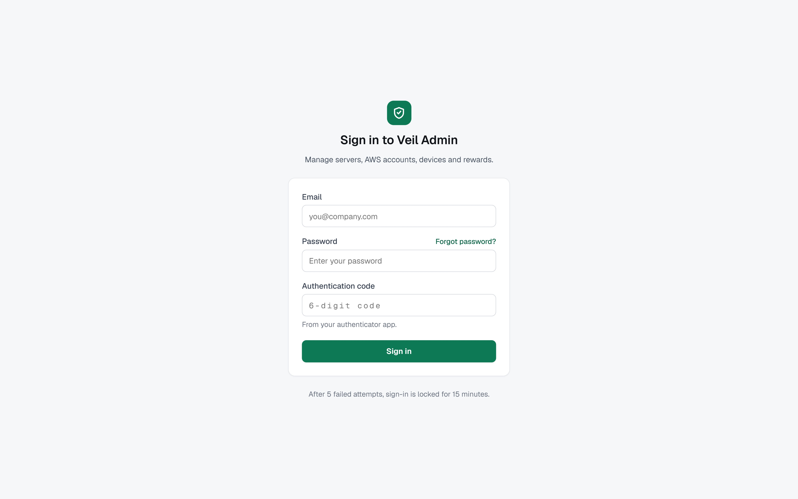

### Page 2

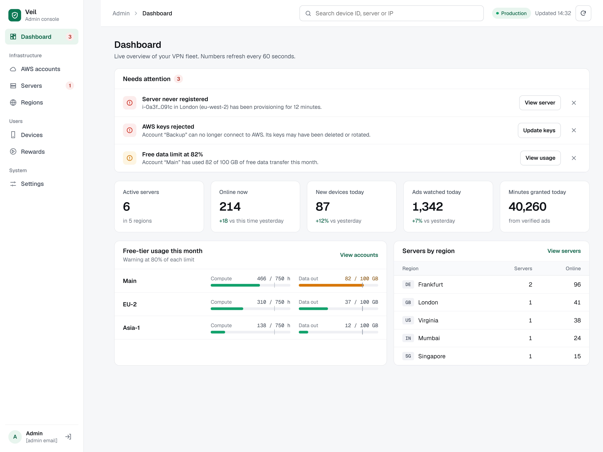

### Page 3

### Page 4

### Page 5

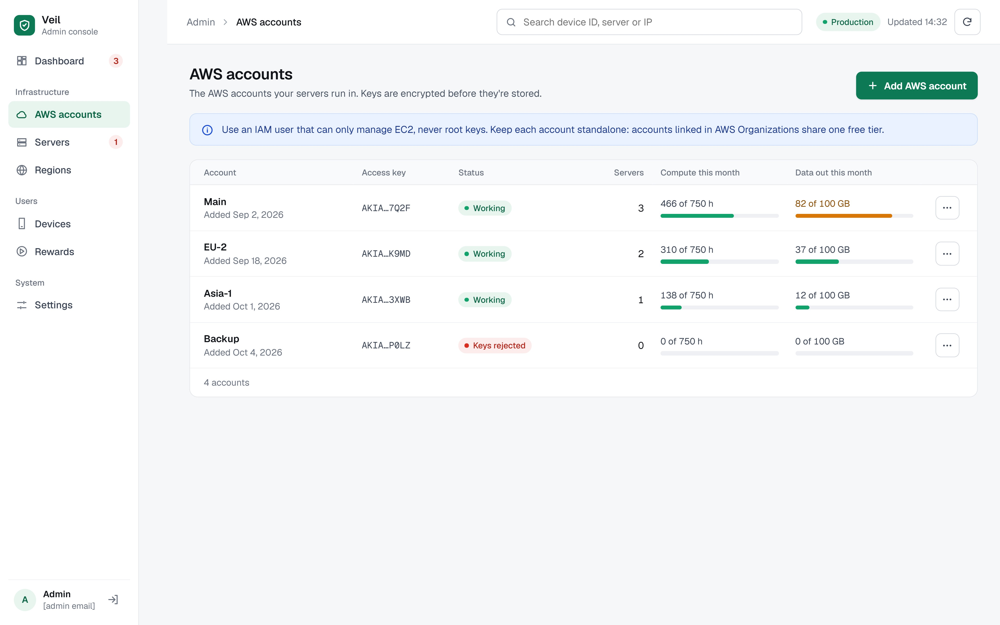

### Page 6

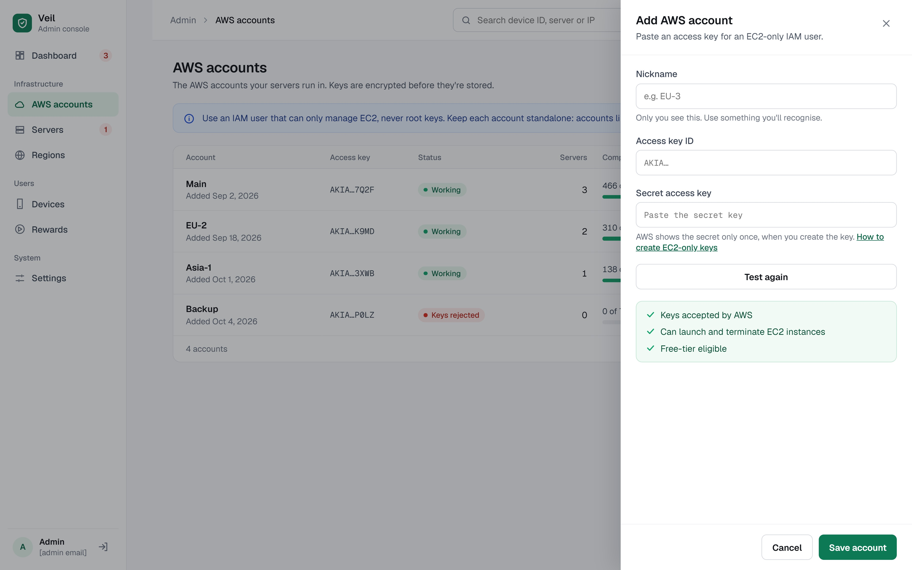

### Page 7

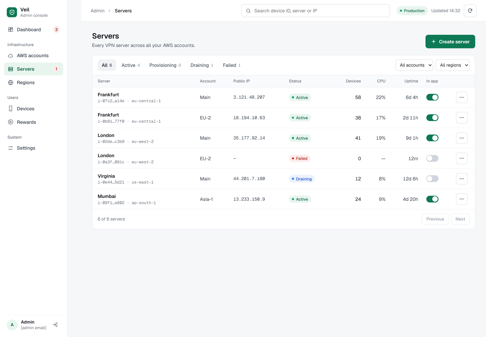

### Page 8

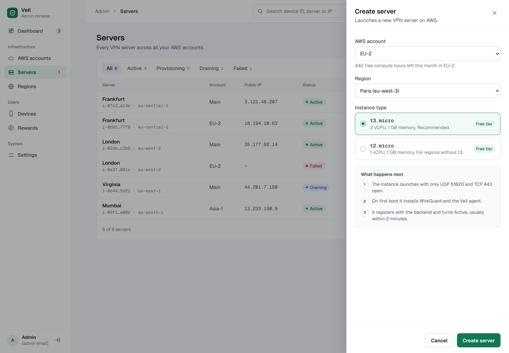

### Page 9

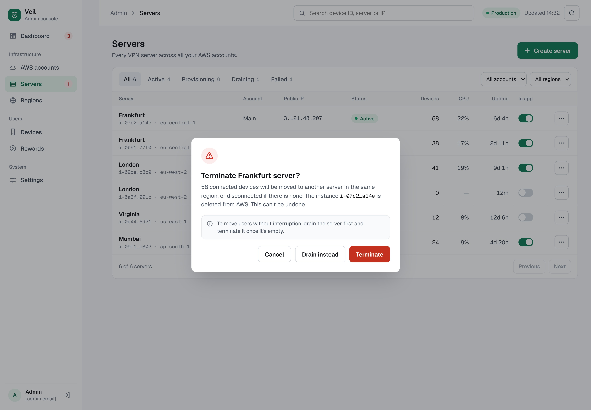

### Page 10

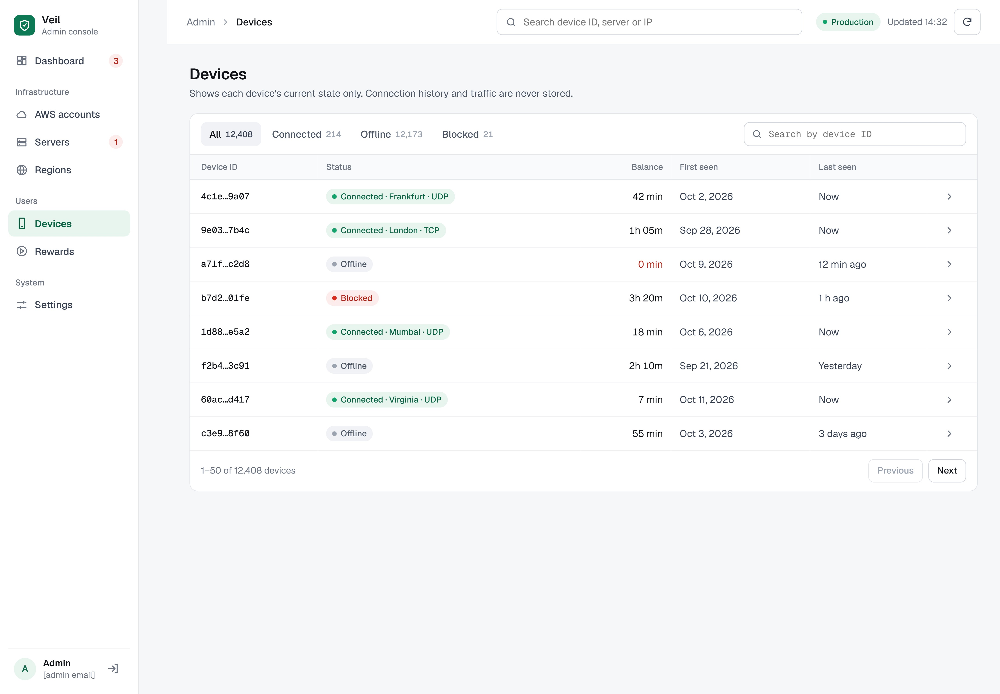

### Page 11

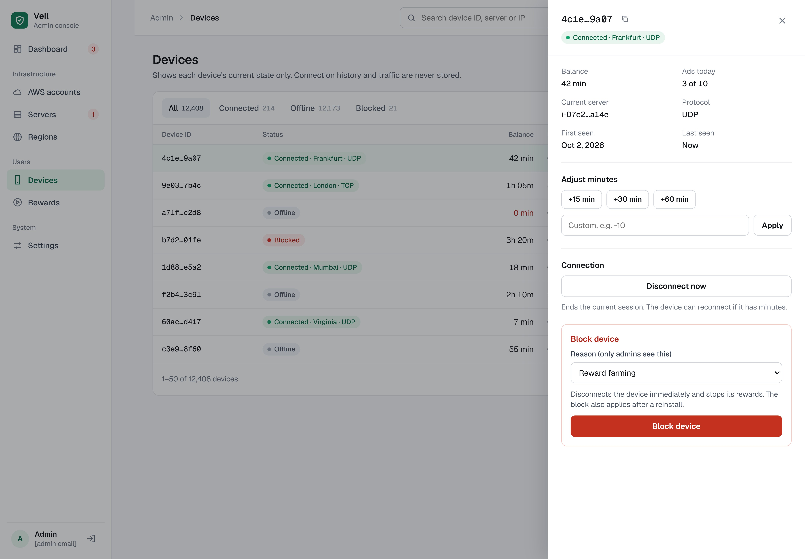

### Page 12

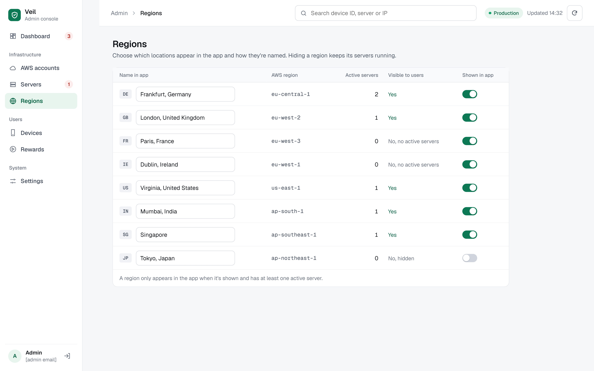

### Page 13

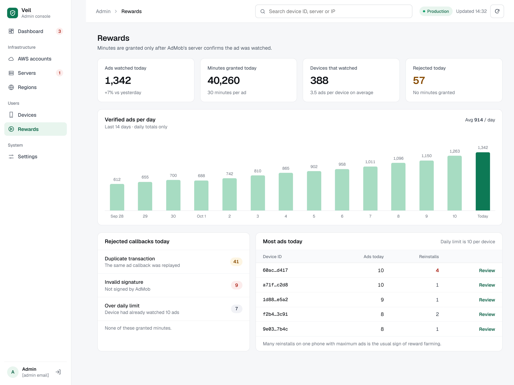

### Page 14

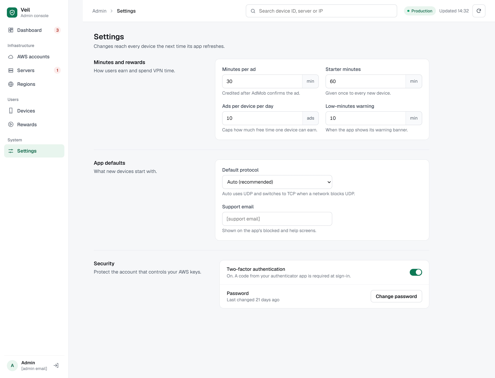
