Veil

Private internet,
free with a few ads.

Connect in one tap. Watch a short ad whenever
you need more time.

No sign-up
Open the app and connect. That's it.

No activity logs
We never record the sites you visit.

Watch ads, earn time
Each short ad adds free VPN minutes.

You start with 60 free minutes

Get started

On your first connection, Android will ask you to allow a VPN.
By continuing you agree to the  Terms  and  Privacy Policy.

Veil

TIME LEFT
1h 12m

Get more time

Not protected

Tap to connect · your IP is visible

DE

Frankfurt, Germany
Fastest location · 38 ms

Protocol: Auto

Veil

TIME LEFT
1h 12m

Get more time

Connecting…

Setting up a secure tunnel

DE

Frankfurt, Germany
Fastest location · 38 ms

Trying UDP first

Veil

TIME LEFT
1h 11m

Get more time

Protected

Traffic encrypted · 00:14:32

DE

Frankfurt, Germany
Fastest location · 38 ms

WireGuard · UDP

Veil

TIME LEFT
6 min

Get more time

Only 6 minutes left. Watch an
ad to stay connected.

Watch ad

Protected

Traffic encrypted · 01:05:48

DE

Frankfurt, Germany
Fastest location · 38 ms

WireGuard · UDP

Choose location

Search locations

Fastest location
Picks the best server for you

ALL LOCATIONS

DE

FR

GB

IE

US

IN

SG

JP

Germany
Frankfurt

France
Paris

United Kingdom
London

Ireland
Dublin

United States
Virginia

India
Mumbai

Singapore
Singapore

Japan
Tokyo

38 ms

41 ms

44 ms

47 ms

96 ms

142 ms

186 ms

214 ms

Get more time

Your balance

6 min

+30 min

for watching one short ad

7 of 10 ads left today

Watch ad

Minutes are added after our server confirms the ad. This usually
takes a few seconds.

Settings

CONNECTION

Protocol

Auto

UDP

TCP

Recommended. Uses UDP for speed and
switches to TCP automatically if your network
blocks it.

Kill switch

Blocks all internet if the VPN drops, so nothing
leaks unprotected. Turn on “Always-on VPN”
and “Block connections without VPN” for Veil in
Android settings.

Open Android VPN settings

DNS leak protection
Your lookups stay inside the tunnel

Always on

Auto-reconnect
Reconnects if your network
changes

Always on

ABOUT

Privacy policy

Terms of use

You're out of time

Your VPN connection has ended. Watch a
short ad to get 30 more minutes and
reconnect.

Balance 0 min · 7 ads left today

Watch ad · +30 min

Not now

Can't reach this location

Frankfurt, Germany isn't responding right
now. Try again, or pick another location.

On office or school Wi-Fi? Switch the
protocol to TCP in Settings.

Try again

Choose another location

This device has
been restricted

Veil can't be used on this device right now.
If you think this is a mistake, contact
support and include your device ID.

DEVICE ID
7f3a9e…c21e

Contact support

Veil · now

Connected · Frankfurt, Germany

42 min left · WireGuard UDP

Disconnect

Get more time

Veil · now

6 minutes left

Watch a short ad to stay connected.

Watch ad

## Extracted Images

### Page 1

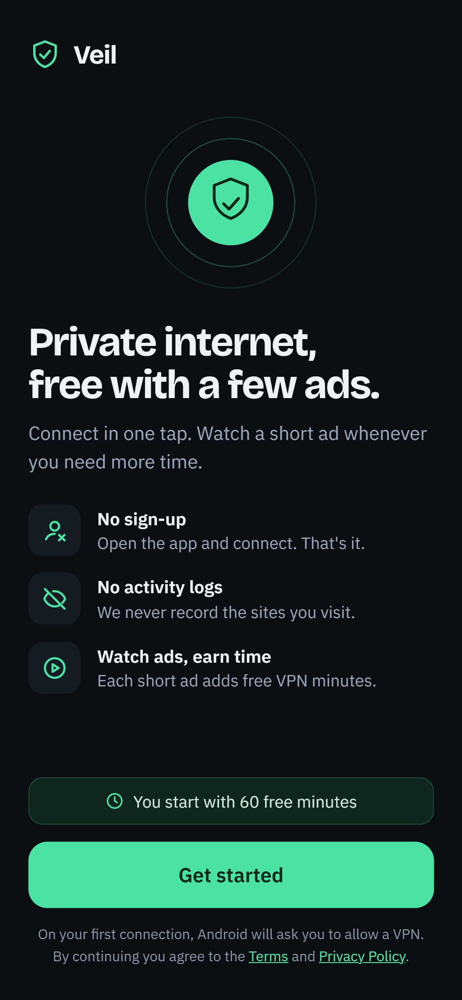

### Page 2

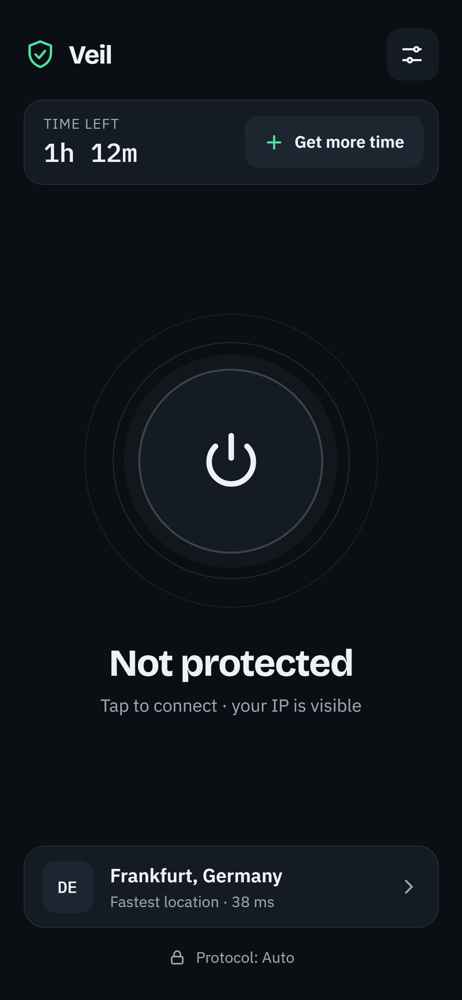

### Page 3

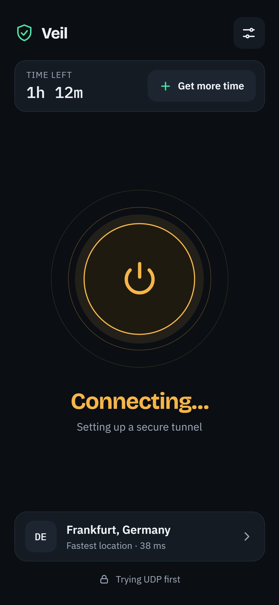

### Page 4

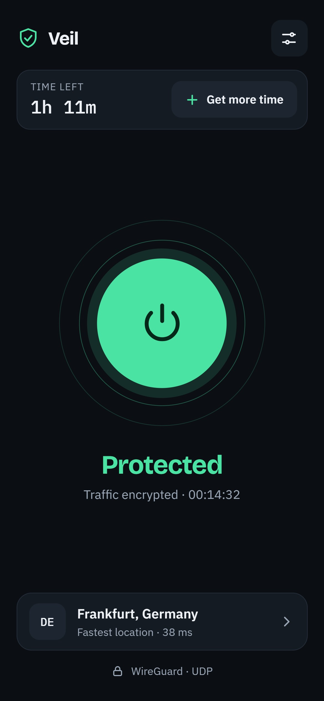

### Page 5

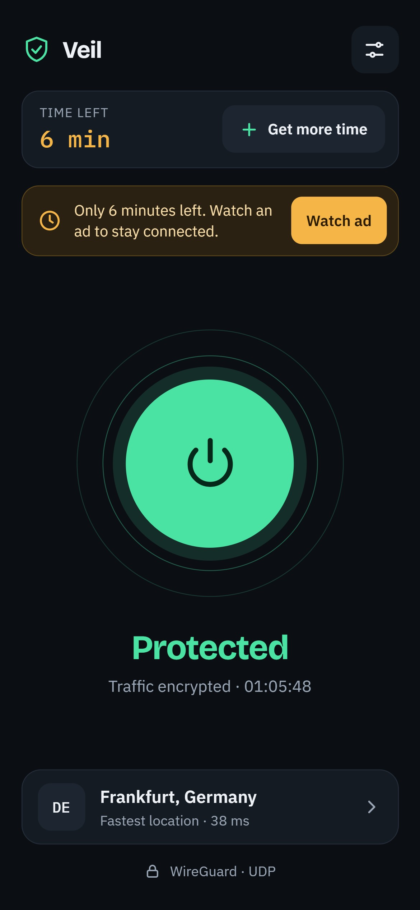

### Page 6

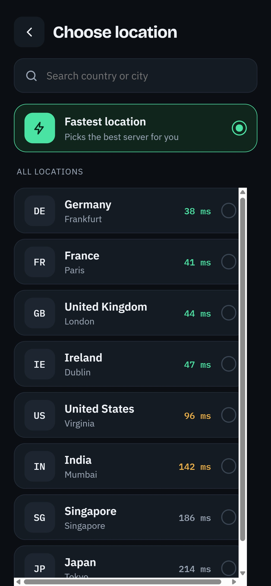

### Page 7

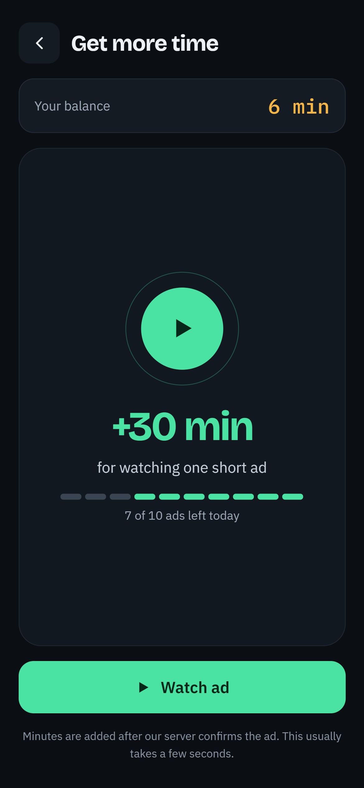

### Page 8

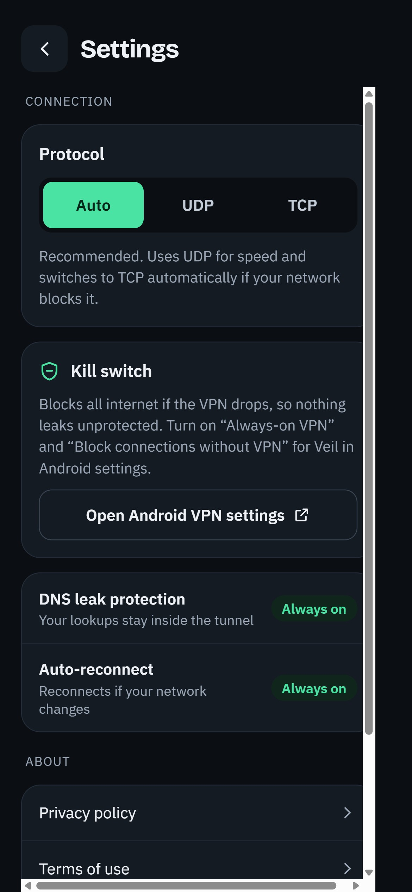

### Page 9

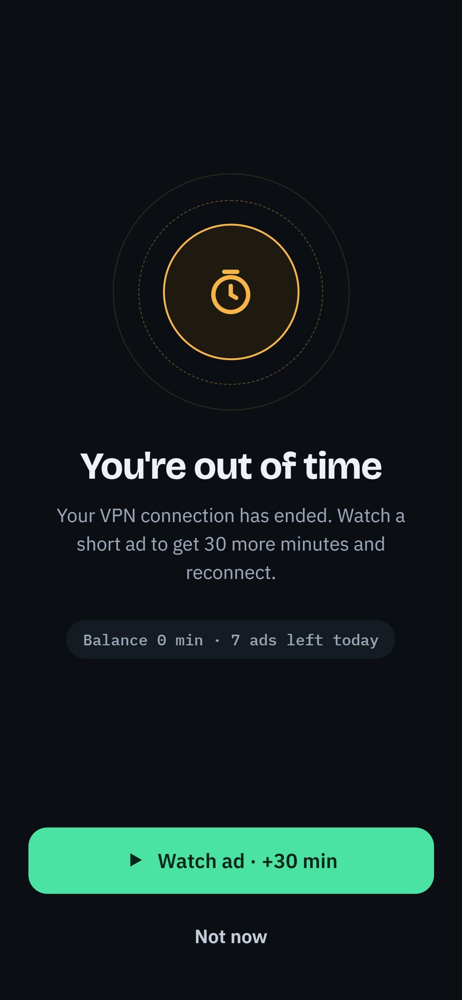

### Page 10

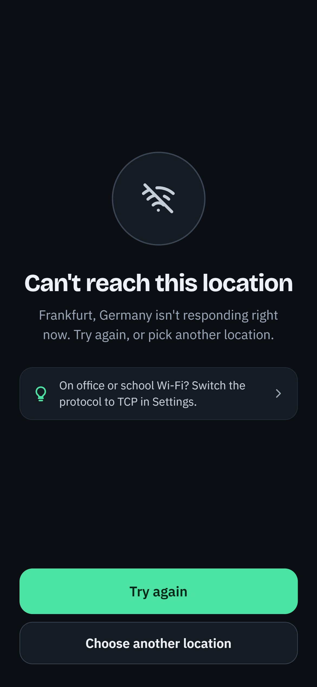

### Page 11

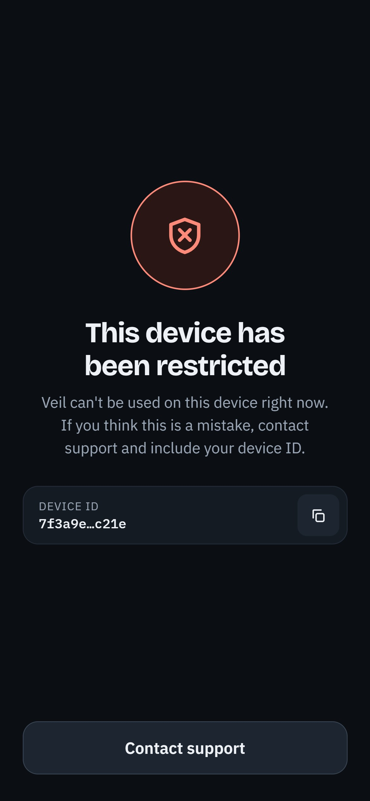

### Page 12

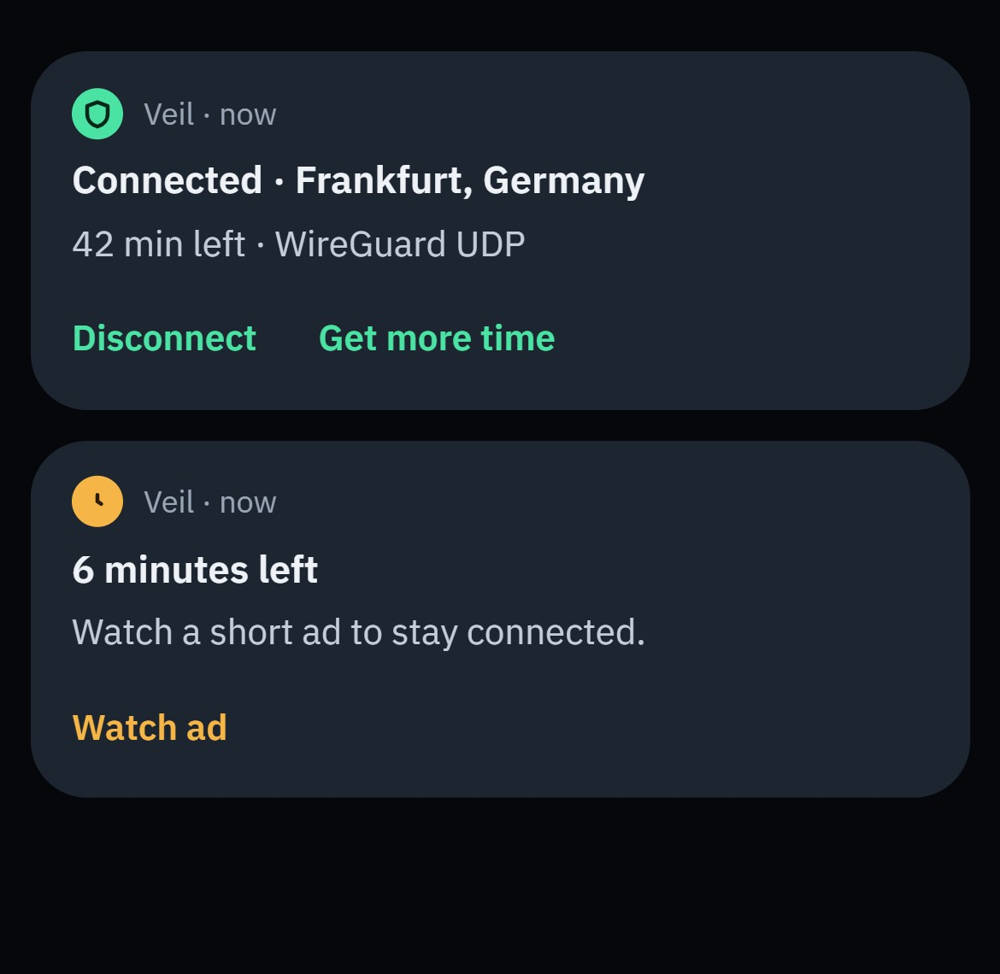
